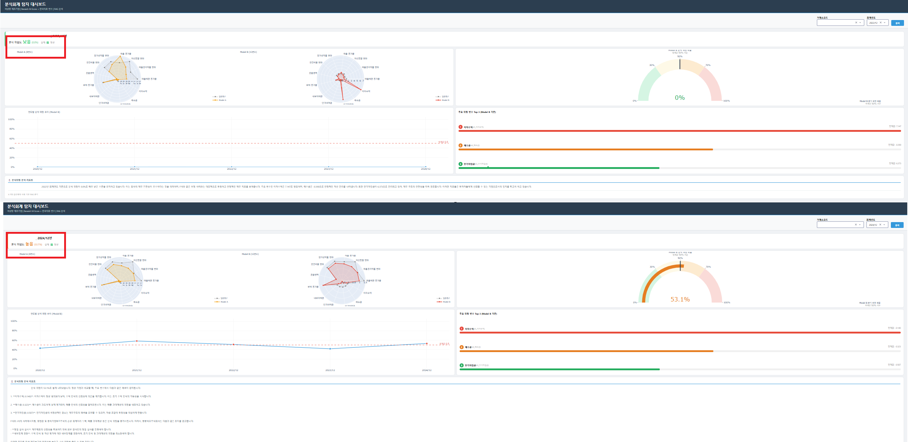
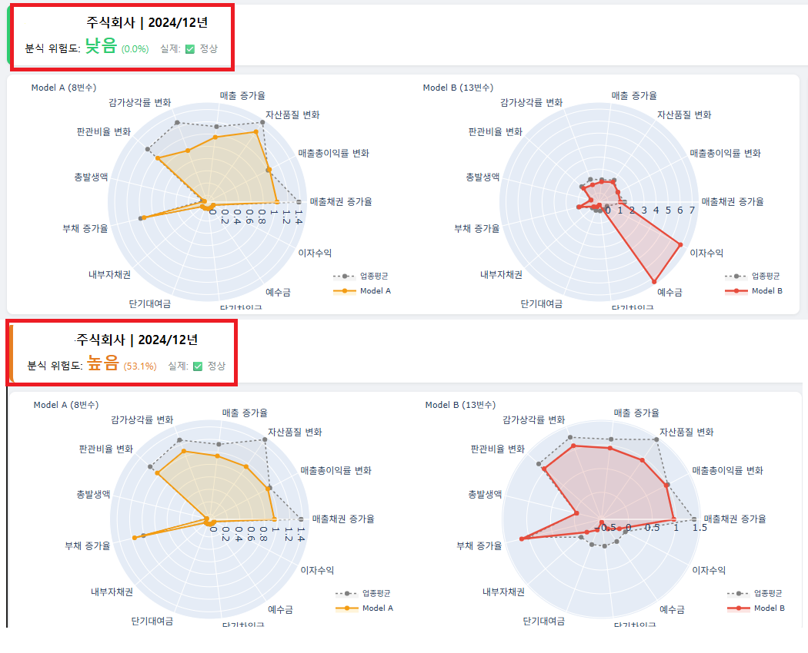
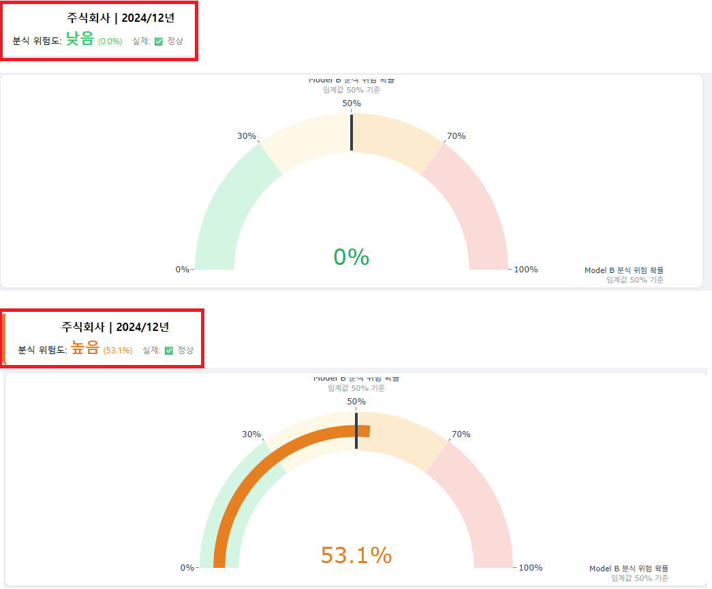
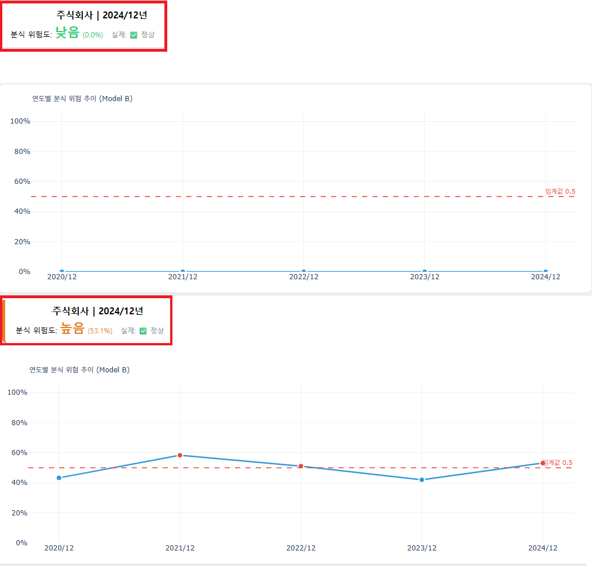
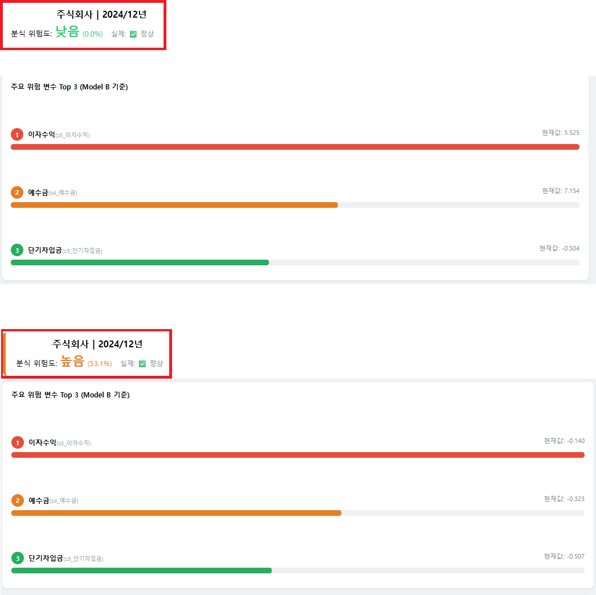
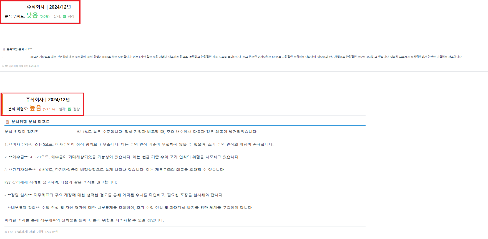

# 📊 분식회계 탐지 대시보드 상세 소개

비상장 제조기업의 재무 데이터로 분식 위험 확률을 계산하고, 유사 감리제재 사례를 검색해 분석 리포트를 생성하는 대시보드입니다.  (Dash + Plotly, LangChain RAG) 

> 🔒 **Data Privacy Notice**  
> 기업 정보 보호 및 보안 준수를 위해 대시보드 화면 내 기업명 및 일부 민감 정보는 가림 처리되었습니다.
> 
### 🟢 [위쪽 화면] 정상 기업 분석 예시

 
### 🔴 [아래쪽 화면] 분식 위험 기업 분석 예시

---

## 1. 조회 화면
- 거래소코드(기업코드+회사명 검색)와 회계연도를 고르고 [분석]을 누르면 결과가 나타납니다. 회계연도 목록은 선택한 기업에 데이터가 있는 연도만 표시되고 최신 연도가 기본값입니다.
- 결과 상단에는 기업명, 연도, 분식 위험도 등급과 확률, 데이터에 기록된 실제 라벨을 함께 보여 줍니다.
- 위험도 등급은 확률 기준으로 낮음(30% 미만), 보통(30\~50%), 높음(50\~70%), 매우 높음(70% 이상)입니다. 

   
---

## 2. 모델 A·B 비교 (레이더 차트)
- Model A는 Beneish M-Score의 8개 변수(DSRI, GMI, AQI, SGI, DEPI, SGAI, TATA, LVGI)를, Model B는 여기에 한국형 특화 변수 5개(내부자채권, 단기대여금, 단기차입금, 예수금, 이자수익)를 더한 13개 변수를 사용합니다.
- 각 차트는 선택한 기업의 변수 값을 업종 평균(점선)과 겹쳐 보여 줍니다. 업종 평균은 업종코드별 전체 데이터의 평균입니다.
- Model A 차트는 8개 변수만 있으므로 나머지 5개 축은 0으로 표시됩니다. 

   
---

## 3. 분식 위험 확률 게이지 (Model B)
- Model B의 분식 위험 확률을 게이지로 표시합니다. 확률 구간별 배경색과 50% 임계값 선이 함께 나옵니다. 

   
---

## 4. 연도별 위험 추이
- 선택한 기업의 모든 회계연도에 대해 Model B 확률을 선으로 보여 주고 0.5 임계값 선과 비교합니다. 임계값 이상인 연도는 점이 빨간색으로 표시됩니다. 

   
---

## 5. 주요 위험 변수 Top 3
- Model B가 판단에 많이 사용한 변수(중요도 상위 3개)를 보여 주고, 선택한 기업의 해당 변수 현재값을 옆에 표시합니다.
- 막대 길이는 상위 3개 중 가장 큰 중요도를 100으로 한 상대 비율입니다.
- 이 순위는 모델 전체 기준이므로 기업별 기여도와는 다릅니다. 

   
---

## 6. RAG 기반 분식위험 분석 리포트
- 위험 등급에 따라 다른 작성 지침을 적용하고, 기업명, 연도, 위험 확률, Top 3 변수와 값을 질의에 담아 금융감독원 감리제재 사례 문서를 검색합니다(상위 4개 조각).
- 검색된 사례를 근거로 GPT-4o-mini(temperature 0.3)가 리포트를 작성합니다. 임베딩은 text-embedding-3-small, 벡터DB는 FAISS를 사용합니다. 

